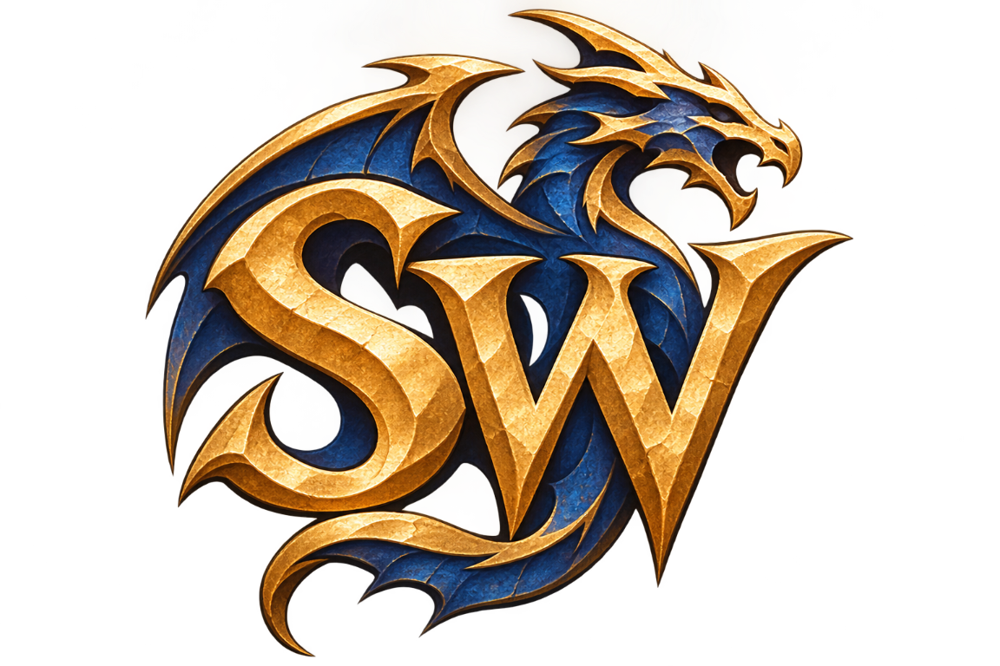

  

# Swonster

**Swonster** is a browser-based monster survival game inspired by 2048. Merge matching monsters to make them stronger, battle an ever-growing enemy threat, and chase a new high score. The challenge is to keep your monsters alive and survive for as many turns as possible.

Head over [here](https://philkisters.github.io/swonster/) to play your first round! 

## Core idea

Move all monsters on the board at once by using the arrow keys, WASD, or touch gestures. When two monsters of the same type and tier collide, they merge into a stronger monster with higher health and attack power.

Position matters: monsters attack adjacent opponents in the direction of movement, and surviving defenders can counterattack. Every valid move adds a new monster to the board, while the spawn preview lets you plan for what is coming next.

The run ends when no friendly monsters remain or there is no room left for the next spawn.

## Increasing pressure

- Merge friendly monsters to build a stronger team.
- Enemy difficulty increases over time as stronger enemy tiers become more likely to spawn.
- Stronger enemies are more dangerous and yield greater point and XP rewards.
- Defeating enemies and merging friendly monsters adds to your score.
- The goal is to set the highest score and survive the most turns.

## License

See [LICENSE](LICENSE).
